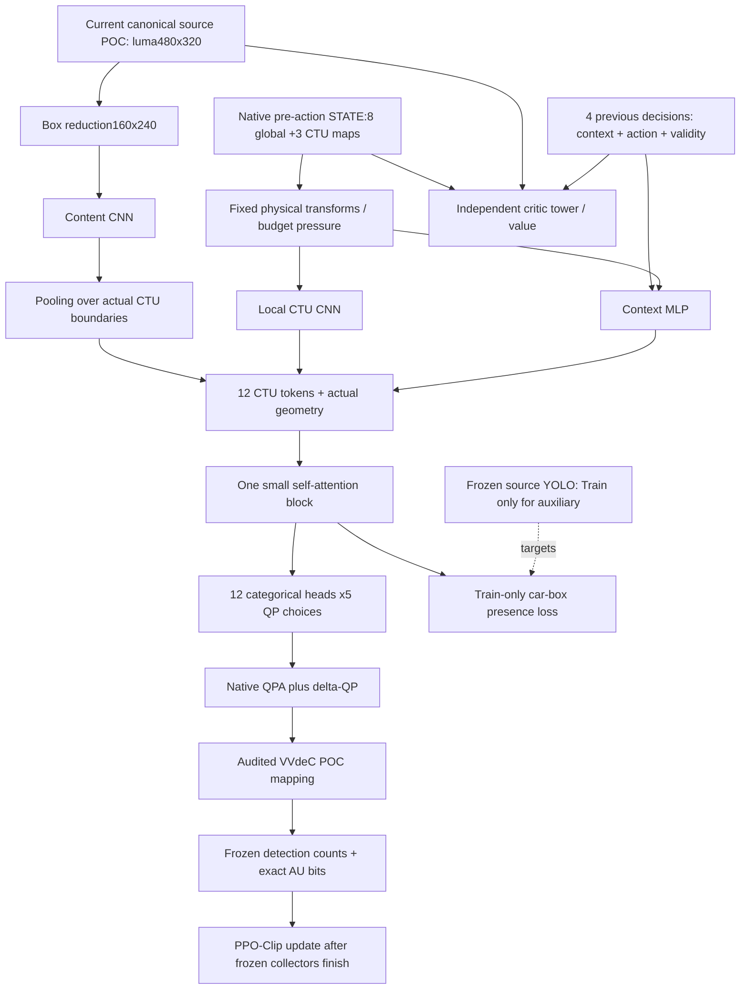

# Agent v4: QP theo nội dung và lịch sử mã hóa

**Lịch sử thiết kế v4.1.** Bản đang dùng là v4.2, có model/update/schema mới,
critic phản thực, paired final-score credit và task-outcome auxiliary. Xem
[learning repair v4.2](AGENT_V42_LEARNING_REPAIR.md) trước khi đọc phần lịch sử
dưới đây. Không dùng mô tả presence-only hoặc MC tail target bên dưới làm hợp
đồng của trainer mới; checkpoint pilot v4.1 không được migrate.

Trạng thái: source triển khai riêng trên `agent-v4-dev`, bắt đầu run mới. Chưa có bằng chứng v4 cải thiện detection–bitrate trên Kaggle. Phần dưới README cũ mô tả các run v2/v3, không phải kết quả của v4.

## 1. Vấn đề cần giải quyết

Source nền: `afaf5f0c463122067bd3ad6ba62f7913c799f900`, nhánh `full-training-dev`. V3 dùng PPO-Clip, GAE, critic độc lập và Gaussian latent được tanh/round thành 12 delta-QP. Đây là một policy-gradient hợp lệ; không coi phép lượng tử là bằng chứng PPO bị sai.

Audit đã có của run v3 cho thấy:

| Bằng chứng | Diễn giải |
|---|---|
| Val EP650: 81/107520 CTU khác0, khoảng0.0753% | Policy triển khai gần zero-map |
| Trên chính các state đó, xác suất nonzero nếu sampling khoảng62.92% | Khám phá lúc training và quyết định deterministic rất khác nhau; không phải chất lượng của một rollout sampling mới |
| Val EP650: delta F1 khoảng−0.0644 điểm phần trăm | Chưa vượt VVenC; critic fit tốt không chứng minh policy tốt |
| State cũ: 3 bản đồ3×4 và8 số global | Thống kê một số/CTU không giữ đủ hình dạng/nội dung đối tượng |
| 975×256=249600 bước ảnh,489 lần PPO update | 3 epoch là một ngân sách thí nghiệm, không phải tiêu chuẩn hội tụ |

Các kết quả này gợi ý thiết kế lại representation, action và objective. Chúng không chứng minh thiếu state là nguyên nhân duy nhất. Headroom của codec, dữ liệu, reward weight và ngân sách tương tác vẫn cần thí nghiệm.

## 2. Cơ sở nghiên cứu và quyết định

| Tài liệu gốc | Điều kế thừa / giới hạn |
|---|---|
| [PPO, Schulman et al.,2017](https://arxiv.org/abs/1707.06347) | Giữ PPO-Clip cho action categorical, nhiều minibatch epoch trên cùng batch on-policy. Không dùng lại rollout cũ để PPO-update policy mới |
| [GAE, Schulman et al.](https://arxiv.org/abs/1506.02438) | Ghi rõ tradeoff bias/variance; v4 clip-delta dùng gamma=lambda=1, tức return Monte Carlo có baseline. Control legacy giữ.99/.95 |
| [RL-RC-DoT, Gadot et al.,CVPR2025](https://arxiv.org/html/2501.12216v2) | Kế thừa điều khiển QP theo vùng và học biểu diễn với tín hiệu task cục bộ. Paper tối ưu precision trên x264; v4 dùng VVenC, clip F1 và auxiliary **car-box presence**, không tự nhận tái hiện nguyên paper |
| [Cong et al.,2026: Inter-Frame R-D Awareness](https://arxiv.org/html/2601.19293v1) | Ý tưởng current-content + thông tin lịch sử/rate. Đây là neural codec với coding parameters khác; không suy ra thuật toán trong paper đã thắng PPO cho VVenC |
| [SAC, Haarnoja et al.,2018](https://proceedings.mlr.press/v80/haarnoja18b.html), [Discrete SAC, Christodoulou,2019](https://arxiv.org/abs/1910.07207) | Off-policy là hướng đối chứng đáng thử khi tương tác codec đắt. Chưa có bằng chứng SAC tốt hơn trong thiết lập này; không đổi thuật toán đồng thời mọi thành phần |

[Puiching-Memory/RL-RC-DoT](https://github.com/Puiching-Memory/RL-RC-DoT/tree/04b4f5acc264a78e8abbc1dd622edcf67ae8636d) là bản tái hiện độc lập, không phải source chính thức của tác giả. Đã đọc environment, policy, PPO auxiliary, training và x264 hook. Không copy code hay so trực tiếp số công bố với số VVenC của đề tài. Đặc biệt, hook này thay native QP-offset; zero action của họ không có cùng semantics với zero delta trên QPA của VVenC.

Paper RL-RC-DoT báo cáo20 triệu bước ảnh với8 môi trường, khoảng4 ngày trên cấu hình của họ. Vì vậy không dùng số epoch của ta để suy ra ngân sách đã tương đương paper. Đây không phải yêu cầu phải chạy20 triệu bước trước khi xem Val.

## 3. Kiến trúc thực sự đã triển khai

Actor và critic có cùng loại input nhưng không dùng chung weights. Model không chạy YOLO trong actor inference. Validation dùng actor-only path, bỏ tính critic và auxiliary head. Khi thu thập Train, critic được chạy để lưu old values.

Sau review, trainer có full-rollout KL guard sau bước actor cuối: backtrack nếu mean joint KL vượt target, phục hồi Adam moments khi giảm bước và lưu `accepted_actor_scale`. Đây là guard thực nghiệm trên batch, không phải bảo đảm return tăng. Chi tiết các lỗi và giới hạn được ghi trong [audit trước pilot](AGENT_V4_AUDIT_20261109.md).

### State và tính nhân quả

`agent_v4/state.py` đọc nguyên định dạng native đã audit; không sửa C++ hay codec binary. State rich gồm:

| Thành phần | Kích thước / nội dung |
|---|---|
| Local |6×3×4: log activity, log temporal pixel proxy, QPA đã căn thang, delta-QP quyết định trước, QPA thay đổi giữa hai quyết định, mask lịch sử |
| Global |16:8 feature gốc đã chuyển thang cùng POC progress, khác biệt decision/display progress, budget error, độ dài episode, thay đổi bộ đếm bits, validity và POC phase |
| History |4×21:8 context +12 action/2 +1 validity, theo **thứ tự quyết định** |
| Content |Luma160×240 từ canonical YUV420p8, chỉ đọc POC hiện tại bằng mmap |
| Geometry |Tọa độ tâm và diện tích thật của12 CTU; cột cuối96px, hàng cuối64px |

`temporal` gốc là sai khác pixel, không phải motion vector. `POC%32` là phase được suy ra, không phải reference graph đã parse. Bộ đếm bits là context đã có trong native STATE, có thể trễ do scheduler; không thay bằng bits cuối cùng của current picture. Canonical source cũng không được mô tả là đúng bằng buffer MCTF nội bộ.

Activity dùng log1p để tránh tín hiệu nhỏ bị bỏ qua; QP dùng đơn vị chênh lệch quanh32. Các phép biến đổi cố định theo đơn vị vật lý, không fit scaler trên Val/Test. Chưa bổ sung field native mới như `TRCPassStats`, motion cuối encode hay PSNR: muốn dùng phải audit readiness và đúng POC/pass trước. Đây là lựa chọn giữ codec/profile đã kiểm chứng trong phiên bản đầu.

Content branch **thay đổi information budget** so với agent chỉ có encoder statistics. Phải nêu khác biệt khi so sánh. Không lấy source detections làm input actor. Lịch sử reset ở mỗi episode; không mang state qua video/clip khác.

### Actor và action

Local CNN, context MLP và descriptor ảnh theo CTU tạo12 token64 chiều. Một block attention4 head cho phép policy dùng thông tin vùng khác khi phân bổ bits. Attention không tự biến policy thành phân phối joint có tương quan: conditional action vẫn factorized theo12 CTU.

Mỗi head có5 xác suất cho delta-QP `{-2,-1,0,1,2}`. Sampling và PPO log-prob đều dùng **đúng integer action gửi encoder**; joint log-prob và exact KL là tổng trên12 head. Deterministic inference lấy argmax của từng categorical, không round Gaussian mean. Zero delta vẫn là quyết định hợp lệ.

Prior ban đầu xấp xỉ xác suất5 bin của Gaussian v3 (`mu=0`, `logstd=−.7`), không ép uniform để tăng nonzero. Entropy regularizer dùng **trung bình entropy/CTU**, hệ số.01; log-prob/KL vẫn là joint sums. Hai đơn vị này được ghi rõ, không tráo hệ số.

### Auxiliary supervision

Frozen YOLO trên **source Train** tạo boxes. Code tính diện tích **hợp** các box giao từng CTU, chia diện tích CTU thực tế; box chồng nhau không được cộng hai lần. Loss actor dùng nhãn có giao car box hay không (`area>0`), BCE với positive weight3, coefficient.1. Nhãn presence giúp xe nhỏ vẫn tạo gradient; không phải pixel segmentation hay local detection reward tối ưu.

Auxiliary gradient đi vào actor representation, không đi vào critic. Không dùng nhãn Val/Test để cập nhật. Chưa có offline pretraining từ archive v3, replay PPO hay behavior cloning action v3 trong bản này. Auxiliary đang học cùng các rollout Train mới. Các hệ số là điểm khởi đầu cần Val/ablation.

## 4. Reward và checkpoint selection

Default là `clip-delta`, symmetric rate penalty, beta.1:

$$S_t=F1_{\mathrm{prefix},t}-\beta\left|\log\frac{B_{1:t}\,fps/t}{R_{\mathrm{target}}}\right|,\quad r_t=S_t-S_{t-1},\quad S_0=0$$

TP/FP/FN được ghép đúng `(video_id,POC)` rồi cộng theo thứ tự quyết định. Bits là số bit AU thật của cùng các POC, tổng được kiểm bằng kích thước bitstream. F1 là micro F1 của prefix, không phải trung bình F1 từng frame. Prefix không có reference car thì quality bằng `−.25×FP/t`; empty-empty bằng0.

Với episode đầy đủ và gamma1:

$$\sum_{t=1}^T r_t=S_T$$

Training và Val chọn checkpoint theo cùng return này. Hai GPU collector giữ `done=True` riêng ở mỗi clip; không nối GAE qua clip. Default lambda1 tránh thêm bias GAE cho objective này, đổi lại variance có thể cao. Đây là **objective mới**, không phải phép shaping được chứng minh giữ nguyên objective v3 gamma.99. Prefix reward có thể lớn lúc đầu và đổi dấu, cần xem variance và Val; không chỉ nhìn mean reward.

`--reward legacy-frame` giữ reward frame/cumulative-rate của v3 và gamma.99/lambda.95 để đối chứng. Selector lúc đó dùng discounted return giống training, đồng thời vẫn lưu clip F1, clip score và actual bitrate. Không so best-score trực tiếp giữa hai loại reward.

`--rate-mode cap` là thí nghiệm khác: chỉ phạt overshoot; tolerance là ngưỡng trong log-rate với factor `(1+tolerance)`. Default vẫn symmetric để không âm thầm đổi từ target adherence sang upper-bound budget. Mỗi thay đổi beta, tolerance hoặc mode bắt buộc tạo run mới.

Reward và entropy là surrogate. Không có đảm bảo bitrate cứng, cải thiện BD-rate, hay beta.1 tối ưu. Bảng actual-bitrate/F1 và RD curves trên cùng clip vẫn cần xem trước khi kết luận.

Trainer v4 dùng4 PPO epoch/minibatch32 và entropy trung bình/CTU, khác trainer v3 (5/64 và entropy tổng). Preset categorical-control giữ backbone/state cũ, nhưng không được diễn giải chênh lệch với checkpoint v3 thành tác động thuần của một biến action. Các thí nghiệm state/content trong v4 dùng cùng trainer để so công bằng; muốn tách riêng action-vs-v3 phải match cả budget và hyperparameters/đơn vị entropy.

## 5. Vì sao tiếp tục PPO; phạm vi Partition/MTS

Giữ PPO để xác định lợi ích của representation/action/objective mới trước. SAC có thể tận dụng replay khi encode đắt, nhưng vanilla continuous SAC không khớp trực tiếp12 quyết định QP rời rạc. Enumerate joint categorical cần `5^12=244140625` tổ hợp; cần SAC factorized/structured critic hoặc thiết kế khác, không chỉ thay tên optimizer.

Partition và MTS có ít action hợp lệ ở từng CU/TU nên masked PPO hoặc Discrete SAC đều đáng nghiên cứu. State/action/reward phải theo đúng stage của encoder. Bản này **chỉ tích hợp QP**, chưa có CU/TU bridge, action masks hay policy Partition/MTS. Không coi cùng network picture-level là đủ dùng cho cả ba.

## 6. Kiểm chứng và kế hoạch training

Các entry point ở `scripts/rl/agent_v4_*.py`; code v3 giữ nguyên. Xem [hướng dẫn chạy](AGENT_V4_RUN.md).

1. Unit/contract tests: categorical LP, auxiliary gradient, actor/critic tách biệt, nguồn current-POC, CTU biên, reward telescoping, GAE boundaries, bridge dòng dở/POC reorder, archive và resume. Fixture synthetic kiểm tra orchestration, **không chứng minh chất lượng codec**.
2. Native preflight32 frame: zero/initial mode byte-identical với VVenC, fixed−2 có tác động, AU accounting, bridge parity và decode/POC audit. Chạy trên codec thật trong môi trường đích trước training.
3. Pilot10 episode rồi so4 cặp Val nhanh; tiếp tục khoảng50k bước ảnh và chạy đầy đủ35 cặp Val nếu có tín hiệu. Đây là mốc xem xét, không phải tiêu chuẩn hội tụ.
4. So sánh theo cùng interaction budget, window schedule, seeds và input budget. Các preset: `categorical-control` giữ nguyên backbone/state44 của v3 và chỉ thay action head; `encoder-history` dùng state/history mới; `content-task` thêm source CNN. Dùng `--auxiliary 0` và cùng `--reward legacy-frame` để tách tác động của từng thành phần trước khi thử objective mới.
5. Quick probes không tranh `best_checkpoint`; chỉ full Val7×5 cùng frame protocol mới chọn best. Val256 frame vẫn là clip Val, chưa phải final full-video evaluation.
6. Khi kết quả đủ ổn mới chạy Test và tính BD-F1/BD-mAP đúng protocol, khoảng chất lượng giao nhau và bootstrap theo video. Pseudo-label F1 không được gọi thành mAP với ground truth. Tập Test cũ đã được xem nhiều lần: nếu dùng để báo cáo v4 sau tuning, phải nêu giới hạn hoặc giữ thêm một tập chưa xem để xác nhận.

Nghiệm thu kỹ thuật không đồng nghĩa agent đã học tốt. Chưa huấn luyện v4 trên T4×2 trong lần triển khai source này; không chốt checkpoint v4 hay tuyên bố vượt EP650/VVenC.
